<p align="center">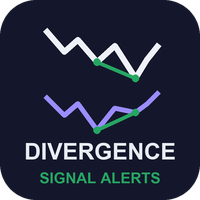</p>

# Divergence Signal Alerts (MetaTrader 5 and MetaTrader 4)

A free indicator that finds **RSI and MACD divergences** on the chart, draws a line between the two price pivots and puts
an arrow on the bar where the divergence became known, **on closed bars only**, with an alert for each one. Source for both
editions, a Python reference of the maths, and the tests that were used to check that the MT5 and MT4 code, the Python
reference and each other all agree.

**Website:** [allanninal.dev/mql5 (indicators)](https://www.allanninal.dev/mql5/#indicators) · [MT4 editions](https://www.allanninal.dev/mql5/#mt4) · [allanninal.dev](https://www.allanninal.dev)
· **Contact:** message me on [LinkedIn](https://www.linkedin.com/in/allanninal/).

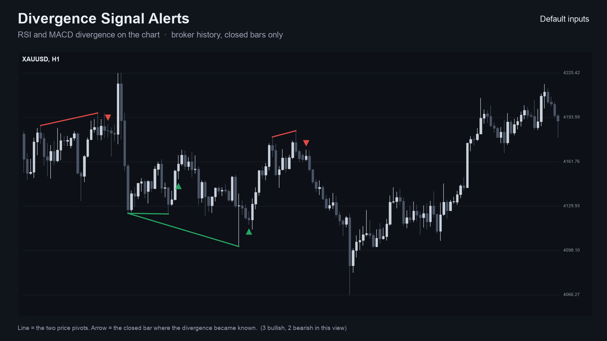

> It is an indicator, not a strategy. It draws lines and arrows and places no trades. Nothing here is a profit claim
> (see [Honest limits](#honest-limits)).

## Get it on the MQL5 Market

| Edition | Platform | Price | Link |
|---|---|---|---|
| Divergence Signal Alerts | MT5 | free | <https://www.mql5.com/en/market/product/201785> |
| Divergence Signal Alerts MT4 | MT4 | free | <https://www.mql5.com/en/market/product/202356> |
| Divergence Scanner MT5 | MT5 | paid | <https://www.mql5.com/en/market/product/201796> |
| Divergence Scanner MT4 | MT4 | paid | <https://www.mql5.com/en/market/product/202403> |

The Market builds are the same calculation as the source in this repository. The two scanner editions are a separate,
paid product that is **not** part of this repository (see [Free vs Pro](#free-vs-pro)).

## Contents

1. [What it is and who it is for](#what-it-is-and-who-it-is-for)
2. [Why it was built](#why-it-was-built)
3. [How it works](#how-it-works)
4. [Non-repainting: the proof and how it was tested](#non-repainting-the-proof-and-how-it-was-tested)
5. [Architecture and buffers](#architecture-and-buffers)
6. [Inputs, alerts, install and compile](#inputs-alerts-install-and-compile)
7. [Run the Python reference and the tests](#run-the-python-reference-and-the-tests)
8. [Honest limits](#honest-limits)
9. [Free vs Pro](#free-vs-pro)
10. [Licence and credits](#licence-and-credits)

## What it is and who it is for

**What:** classic oscillator divergence as a native MetaTrader indicator. It finds swing lows and highs on price, compares
two consecutive swings with the RSI and the MACD histogram, and when price and oscillator disagree it draws a line between
the two price pivots and an arrow (bullish below the candle, bearish above) on the bar where the divergence became known.
**Regular** divergence (a reversal hint) is on by default; **hidden** divergence (a continuation hint) is optional. Alerts:
pop-up, sound, push, e-mail.

**For:** traders who use divergence and want it marked without repainting, and who want to know that the arrow they saw will
still be there tomorrow. Also for developers who want a small, tested indicator with documented buffers to read from an EA
with `iCustom`.

**Not for:** anyone who expects a divergence to call a turn. It marks where price and oscillator disagreed.

| | |
|---|---|
| 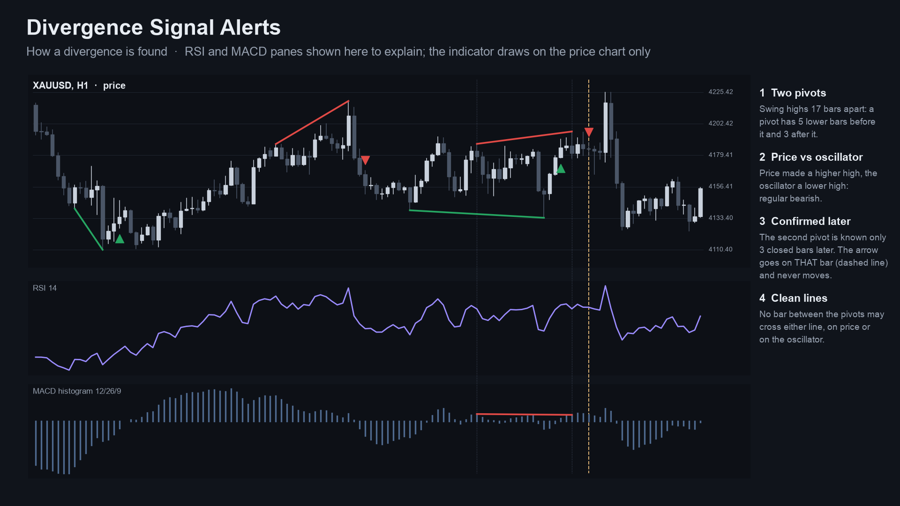 | 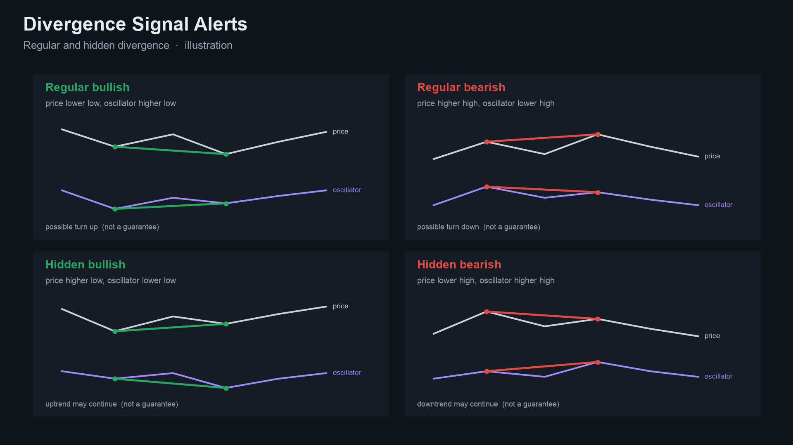 |
| 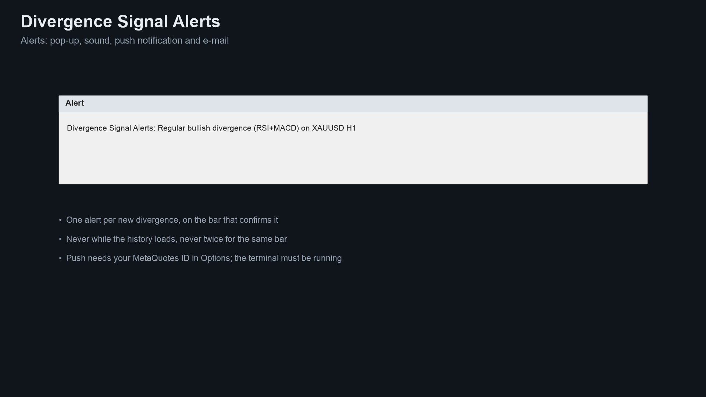 | 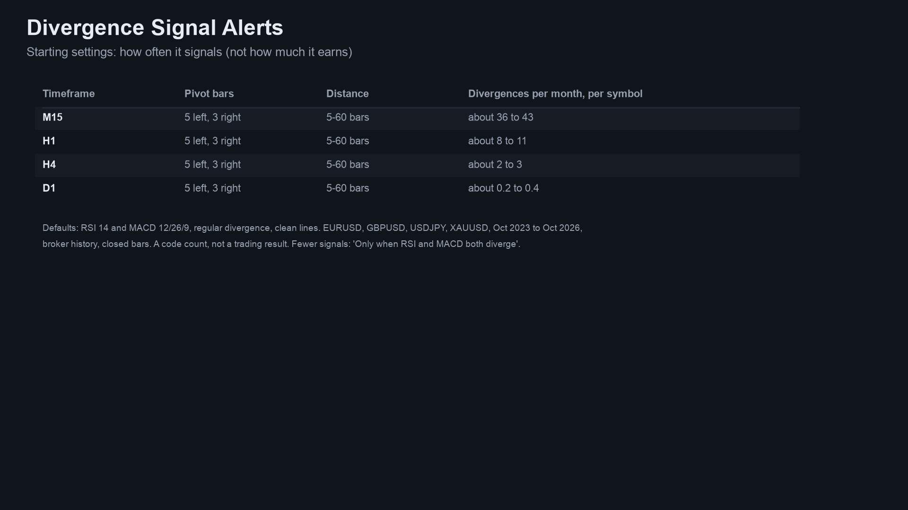 |

Image notes: the charts are drawn by the Python reference on broker history (the same numbers the indicator shows); the
alert pop-up is a mock-up around the indicator's real text. They are illustrations, not terminal captures. MT4 versions
are in [`docs/images/mt4/`](docs/images/mt4).

## Why it was built

Divergence is among the most-used classic methods. The motivations, stated with the evidence we actually have:

- **A native, readable implementation.** Hundreds of divergence indicators exist on the MQL5 Market (we counted about 240
  MT5 indicators in the October 2026 research), many closed-source, and the most popular single-oscillator ones sell at
  about 30 USD. A free, documented one is a useful reference.
- **Trust in the arrows.** The same research found repeated complaints about arrow indicators that repaint, and a 2026-07
  request for "arrows confirmed on bar close". A divergence needs bars after the pivot to exist, so this indicator draws
  its arrow on the bar that *confirms* it and never moves anything into the past.
- **Honest scale of demand.** Named classic methods are requested only rarely on freelance boards (divergence among them),
  while forum users do ask for divergence versions of their favourite oscillators. So this is a free tool that builds a
  track record, not a claim of mass demand.
- **Provable behaviour.** Every number in this README comes from an executed check, listed below, not from a promise.

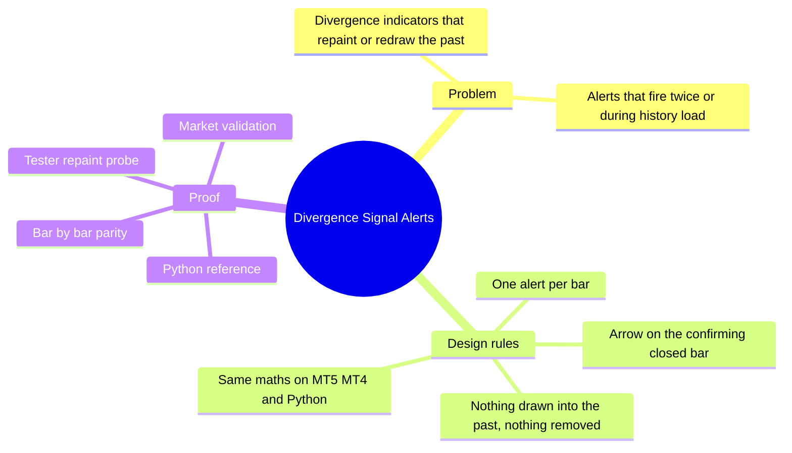

## How it works

### The maths, step by step

Let `H, L, C` be a bar's high, low and close, `k` the index of the bar just closed (oldest = 0), `left` and `right` the pivot
bars (defaults 5 and 3).

1. **Oscillators**, computed on every closed bar:

   - **RSI** (Wilder, period 14): gains and losses smoothed with an RMA seeded with the simple average of the first 14
     changes; `RSI = 100 - 100 / (1 + gain / loss)` (100 when the loss is 0, 0 when the gain is 0).
   - **MACD histogram**: `EMA(12) - EMA(26)` minus the `EMA(9)` of that line. Every EMA is seeded with the simple average
     of its first `n` values, then `EMA = EMA + 2/(n+1) * (x - EMA)`.

2. **Pivots on price.** Bar `p = k - right` is a **pivot low** if its low is below the low of each of the `left` bars before
   it and not above the low of any of the `right` bars after it. A **pivot high** mirrors it. A pivot is therefore known
   `right` bars after it formed: bar `k` is its *confirmation bar*.

3. **Compare with the earlier pivots.** The engine remembers the last four pivots of each side. At a new pivot low `p`, the
   earlier pivot lows `q` are tried, nearest first, if they are between `min` and `max` bars back (defaults 5 and 60):

   - **regular bullish**: `low[p] < low[q]` and `osc[p] > osc[q]` (price lower low, oscillator higher low)
   - **hidden bullish**: `low[p] > low[q]` and `osc[p] < osc[q]` (price higher low, oscillator lower low)

   A new pivot high mirrors it for bearish divergence (regular: price higher high, oscillator lower high; hidden: price
   lower high, oscillator higher high).

4. **Clean lines** (on by default): no bar strictly between `q` and `p` may cross the straight line from `q` to `p`, on
   price (lows must stay above the line for a bullish pair, highs below it for a bearish pair) or on the oscillator being
   tested. A pair that fails is skipped.

5. **Result.** The first `q` where at least one oscillator (or both RSI and MACD, if *Only when RSI and MACD both diverge*
   is on) diverges is the divergence. The arrow goes on the confirmation bar `k` at its low (bullish) or high (bearish), the
   line joins the two price pivots, and a tooltip names the oscillators that agreed. A bar can be both a pivot low and a
   pivot high; the low is tested first.

The forming bar is never fed to the engine, so nothing on a closed bar changes afterwards.

### Per-bar algorithm

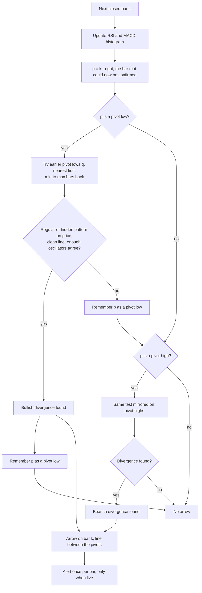

### Signal states

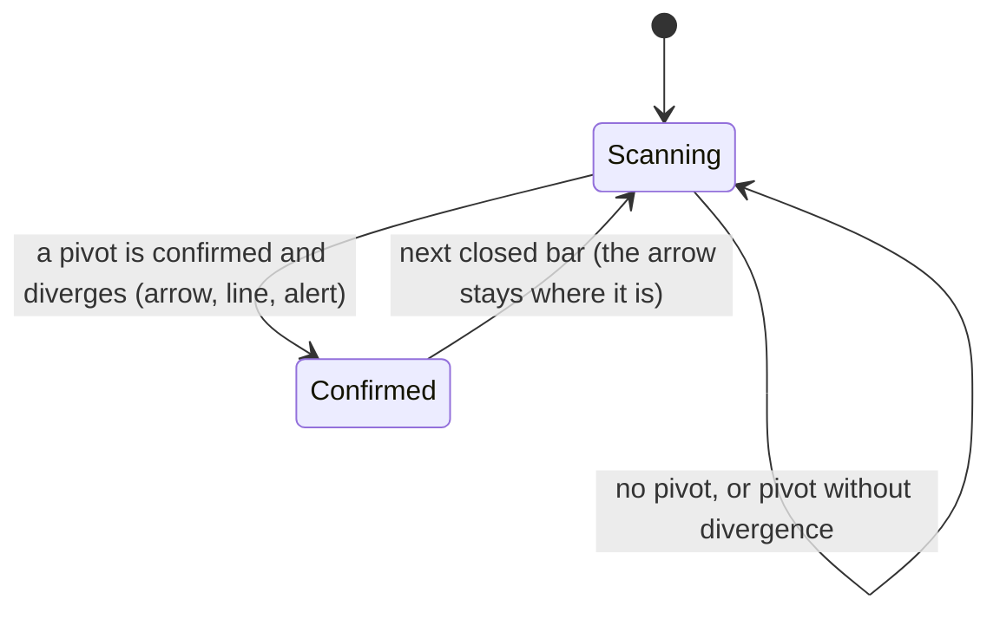

### Alert flow

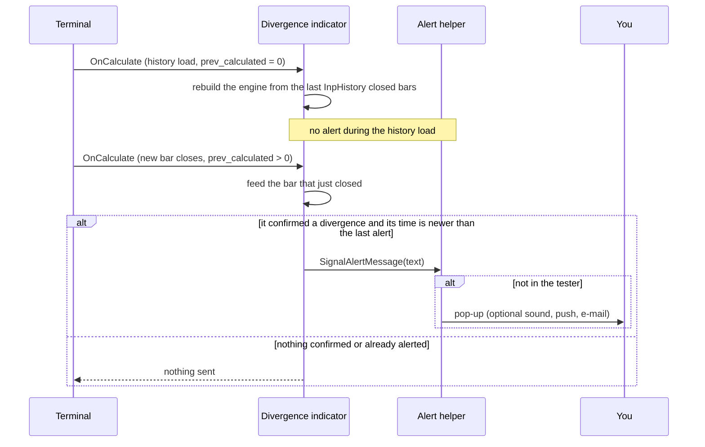

### How often it signals (measured)

Divergence arrows (bullish plus bearish) per month with the default inputs (RSI and MACD, regular, clean lines), on closed
bars of broker history, October 2023 to October 2026. Source: [`docs/data/events-per-month.json`](docs/data/events-per-month.json).
This counts arrows only. It says nothing about profit.

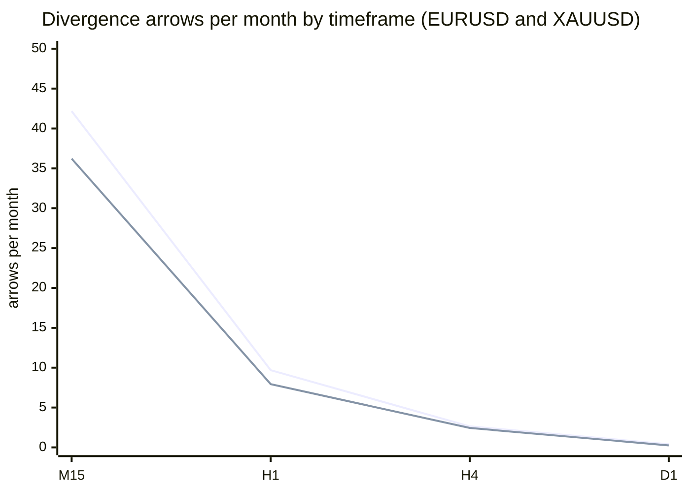

First line EURUSD, second XAUUSD.

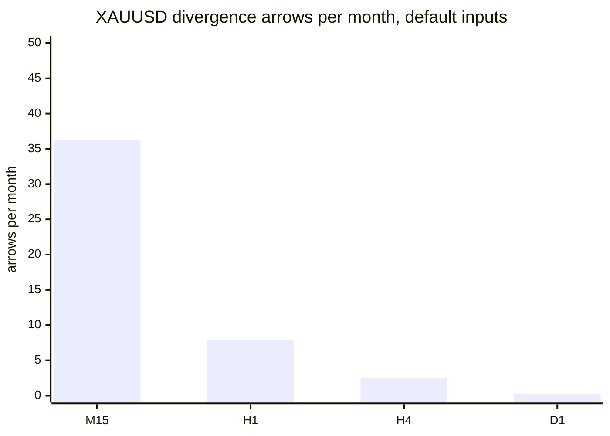

## Non-repainting: the proof and how it was tested

"Non-repainting" is easy to claim. Here is what was actually run. Raw result files are in [`tests/results/`](tests/results).
The tests below were re-run on exactly the code in this repository.

**1. Three implementations, compared bar by bar.** The Python reference
([`tests/reference.py`](tests/reference.py)) is a separate implementation of the same maths. The MT5 and MT4 indicators
were dumped bar by bar (arrows, arrow types, RSI, MACD histogram) in the MetaTrader Strategy Tester, and
[`tests/check_parity.py`](tests/check_parity.py) compared each dump with the reference. Pass means: RSI and MACD within
1e-9 relative on every scanned bar, and arrows of the same type on exactly the same bars.

| | MT5 | MT4 |
|---|---|---|
| dumps compared | 36 (4 symbols x M15/H1/H4 x 3 input sets) | 37 (same 36 + one every-tick EURUSD H1) |
| bars scanned | 84,000 | 768,247 |
| arrows compared (bullish + bearish) | 3,002 | 23,757 |
| result | ALL PASS | ALL PASS |

Symbols: EURUSD, XAUUSD, GBPJPY, BTCUSD. Input sets: defaults; hidden divergence on with both oscillators required; RSI
only with clean lines off, pivot bars 3 and 2 and a 40-bar maximum distance. Source:
[`tests/results/parity-mt5-and-mt4.txt`](tests/results/parity-mt5-and-mt4.txt). The indicator scans the last 2,000 (or 3,000)
closed bars of the chart, which is why the MT5 count is small; the MT4 test scans the whole test history.

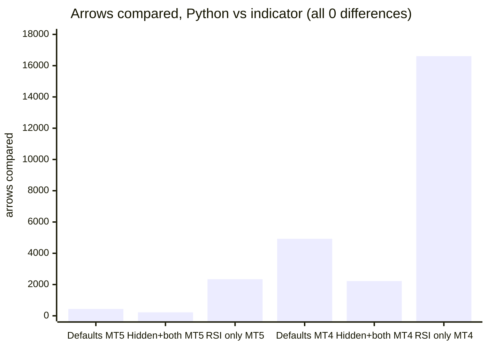

(MT4 "Defaults" is 4,850 arrows over 12 runs plus 74 in the every-tick run = 4,924.)

**2. Repaint probe.** An EA records which signal buffers are set on each bar *at the moment it closes*, then reads the same
bars again at the end and counts any value that changed. It also counts any signal ever shown on the still-forming bar.

| Run | Closed bars checked | Signals seen at close | Changed afterwards | Signals on the live bar |
|---|---|---|---|---|
| MT5, XAUUSD H1, every tick, 91,052,717 ticks | 4,406 | 75 | **0** | **0** |
| MT4, 37 runs combined | 755,574 | 23,429 | **0** | **0** |

Source: [`tests/results/repaint-summary.md`](tests/results/repaint-summary.md). The MT5 repaint probe was run once (XAUUSD
H1, default inputs); the MT4 probe ran on every dump run.

**3. Market validation.** Both Market builds passed the MQL5 Market's automated product validation before publication
(this is the Market's own check, not part of this repository).

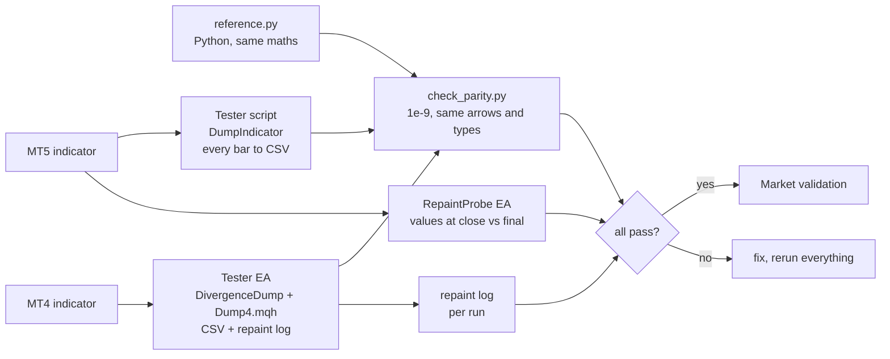

### Why the design cannot repaint

- The engine is fed closed bars only: the loop stops at `rates_total - 2`, so the forming bar is never used.
- A pivot needs `right` closed bars after it, so the arrow is drawn on the bar that confirms it, never on the pivot bar and
  never into the past. Lines are created once and never moved or deleted while the indicator runs.
- Each step depends only on the earlier bars (recursive formulas, no look-ahead).
- Alerts fire only for the bar that just closed, only after the history load, once per bar, and never in the tester.
- The MT4 tester recalculates an indicator from scratch at the end of a run, and a fresh calculation covers only the last
  `InpHistory` bars; the MT4 test therefore stores each bar's values as the live instance produced them and compares those.

## Architecture and buffers

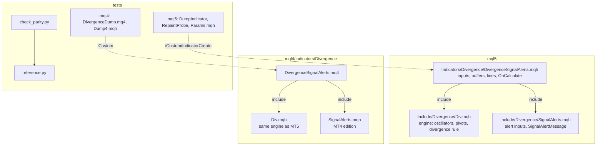

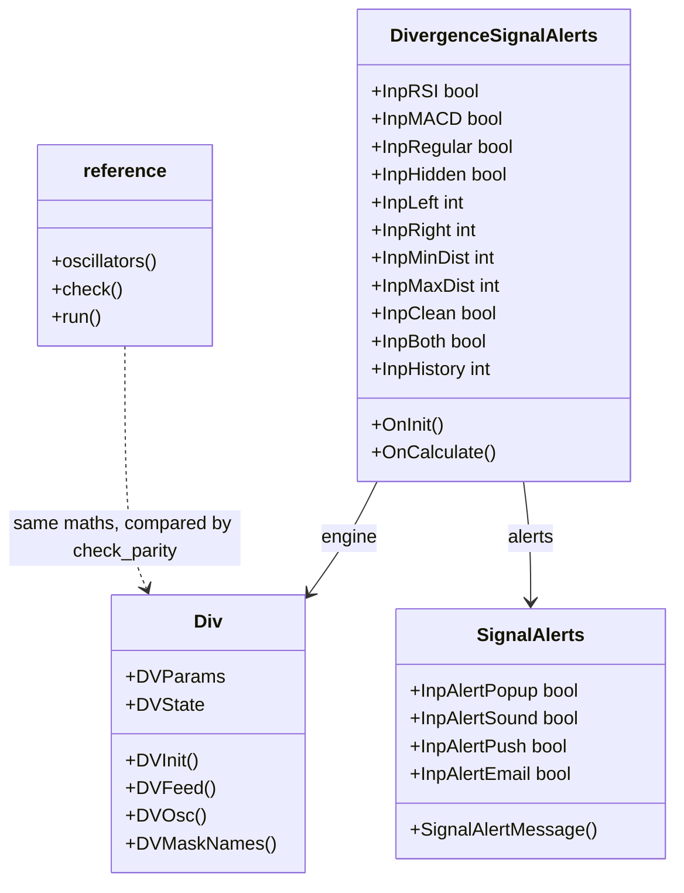

### `iCustom` buffer table (for EA developers)

| Buffer | MT5 and MT4 |
|---|---|
| 0 | **Bullish** divergence arrow price (bar low), empty otherwise |
| 1 | **Bearish** divergence arrow price (bar high), empty otherwise |
| 2 | type of the bullish divergence on that bar (1 regular, 2 hidden) |
| 3 | type of the bearish divergence on that bar (1 regular, 2 hidden) |
| 4 | RSI |
| 5 | MACD histogram |

Empty value is `EMPTY_VALUE`. Read arrows on **closed bars** (shift 1 and higher). `iCustom` parameters follow the input
order: RSI on, RSI period, MACD on, fast, slow, signal, regular, hidden, pivot left, pivot right, minimum distance, maximum
distance, clean lines, both required, closed bars to scan, draw lines, bullish colour, bearish colour, arrow gap (MT4
only), pop-up, sound, sound file, push, e-mail. In MT5 the `input group` headings also count as string parameters when you
build a handle with `IndicatorCreate` (see `tests/mql5/Include/IndTest/Params.mqh`).

## Inputs, alerts, install and compile

| Input | Default | Meaning |
|---|---|---|
| RSI divergence / RSI period | true / 14 | Use the RSI |
| MACD histogram divergence | true | Use the MACD histogram |
| MACD fast / slow / signal EMA | 12 / 26 / 9 | MACD periods |
| Regular divergence (reversal) | true | Price and oscillator disagree at a new extreme |
| Hidden divergence (continuation) | false | Price makes a higher low (or lower high) while the oscillator does the opposite |
| Pivot: bars on the left / right | 5 / 3 | Right bars are the confirmation delay |
| Pivots at least / at most this many bars apart | 5 / 60 | Distance between the two pivots |
| Clean lines | true | No bar crosses the line between the pivots |
| Only when RSI and MACD both diverge | false | Needs both oscillators |
| Closed bars to scan on the chart | 2000 | 100 to 20000 |
| Draw the line between the price pivots | true | Trend line objects |
| Bullish / bearish colour | green / red | Colours of arrows and lines |
| Arrow distance from the candle (MT4 only) | 0.3 x ATR(14) | Gap between arrow and candle (MT5 uses a fixed pixel gap) |
| Pop-up alert | true | Terminal alert window |
| Play a sound / sound file | false / alert.wav | File from the terminal's Sounds folder |
| Push notification | false | Needs your MetaQuotes ID in Options |
| E-mail | false | Needs e-mail set up in Options |

**Alert text:** `Regular bullish divergence (RSI+MACD) on EURUSD H1`.

**Install from source.** MT5: copy `mql5/Indicators/Divergence/` into `<terminal data folder>/MQL5/Indicators/` **and**
`mql5/Include/Divergence/` into `<data folder>/MQL5/Include/`, open `DivergenceSignalAlerts.mq5` in MetaEditor and press
Compile (F7). MT4: copy `mql4/Indicators/Divergence/` into `<data folder>/MQL4/Indicators/` (the three files of the
edition stay together) and compile `DivergenceSignalAlerts.mq4`. Both compile with 0 errors and 0 warnings (checked on a
Windows machine with MetaEditor; the compiled files are not in the repository).

## Run the Python reference and the tests

```bash
python3 -m venv .venv && . .venv/bin/activate && pip install -r requirements.txt
```

```python
import sys; sys.path.insert(0, "tests")
from reference import Params, run
# h, l, c are float sequences of closed bars, oldest first
events, osc = run(h, l, c, Params())   # events keyed by the confirming bar: dir (+1 bull, -1 bear), type, mask, p, q
```

To repeat the parity check on your own data:

1. Compile the indicator and the test tool for your platform (`tests/mql5/Scripts/DumpIndicator`, or `tests/mql4/DivergenceDump.mq4`
   with `tests/mql4/Include/IndTest4/Dump4.mqh` in your `MQL4/Include/IndTest4/`; MT5 also needs `tests/mql5/Include/IndTest/Params.mqh`).
2. Run it in the Strategy Tester (MT4) or as a script (MT5) for each symbol and timeframe, with the input sets in
   `tests/configs.tsv` (MT5) / `tests/mql4/configs.tsv` (MT4). The tool writes one CSV per symbol and timeframe.
3. `python3 tests/check_parity.py <folder>` where the CSVs are in `<folder>/dump/` (or directly in `<folder>`) and named
   `dv_default_*`, `dv_hidden_both_*` or `dv_rsi_noclean_*` (add `--mt4` for MT4 dumps). It prints PASS or FAIL per file
   and an overall result.
4. Repaint: run `tests/mql5/Experts/RepaintProbe` in the MT5 Strategy Tester (every tick); MT4 writes its repaint log with the dump.

The price dumps used for the published numbers are not in this repository (they are broker price data).

## Honest limits

- **An indicator signal is not a strategy.** No stop-loss, position sizing or exit rules are provided or implied, and the
  arrows were not optimised or back-tested for profit. Whether a divergence is followed by a turn depends on your market,
  costs and rules.
- **No profit or accuracy claim is made.** The only numbers here are about *consistency* (the three implementations agree,
  arrows do not move) and *frequency* (arrows per month).
- **Late by design.** A divergence is only known `right` closed bars after its pivot formed, so the arrow always comes after
  the turn it describes.
- **Divergences can persist.** Price can keep making lower lows while the oscillator keeps rising; many divergences are not
  followed by a reversal.
- **Window-dependent.** The oscillators are seeded from the first bar the engine sees and it starts `Closed bars to scan`
  bars back, so the first arrows of a window can differ from a longer one.
- **Scope of the tests.** Four symbols, three timeframes, three input sets, one MT5 repaint run. Other symbols and
  timeframes are not covered by the published numbers. The MT5 build was not run on a live chart as part of these numbers.
- A multi-symbol scanner with three more oscillators exists as a separate paid product (see below).

## Free vs Pro

| | Free: Divergence Signal Alerts | Paid: Divergence Scanner |
|---|---|---|
| Platforms | MT5 [201785](https://www.mql5.com/en/market/product/201785), MT4 [202356](https://www.mql5.com/en/market/product/202356) | MT5 [201796](https://www.mql5.com/en/market/product/201796), MT4 [202403](https://www.mql5.com/en/market/product/202403) |
| Price | free | paid (see the Market page) |
| What you get | RSI and MACD divergences on the current chart, lines, arrows, alerts, source here | A multi-symbol, multi-timeframe scanner of divergences, as described on its Market listing |
| Source | this repository | not published |
| Closed-bar signals, no repaint | yes | see its listing |

No need to buy the paid product to use the free one: the free indicator is complete on its own.
Website: [allanninal.dev/mql5](https://www.allanninal.dev/mql5/#indicators) ([MT4](https://www.allanninal.dev/mql5/#mt4)).
The paid product has a code-free showcase page at [allanninal/divergence-scanner](https://github.com/allanninal/divergence-scanner).

## Licence and credits

**Origin of the maths.** RSI (Wilder), the MACD histogram, swing pivots and oscillator divergence are standard, long-published
technical-analysis definitions. This code is an own implementation written from those definitions; it is not a port of any
particular script.

Everything in this repository is © 2026 Allan Niñal under the
[PolyForm Noncommercial License 1.0.0](LICENSES/PolyForm-Noncommercial-1.0.0.md): free for personal and other noncommercial
use, not for commercial use (source-available, not OSI open source). Each source file has an `SPDX-License-Identifier`
line. Text: [`LICENSE`](LICENSE). The licence applies to this source, not to anything you build or trade with the indicator.
Trading involves risk; the software is provided as is.

---

**Website:** [allanninal.dev/mql5](https://www.allanninal.dev/mql5/#indicators) · [MT4](https://www.allanninal.dev/mql5/#mt4) · [allanninal.dev](https://www.allanninal.dev)
· Questions: message me on [LinkedIn](https://www.linkedin.com/in/allanninal/).
